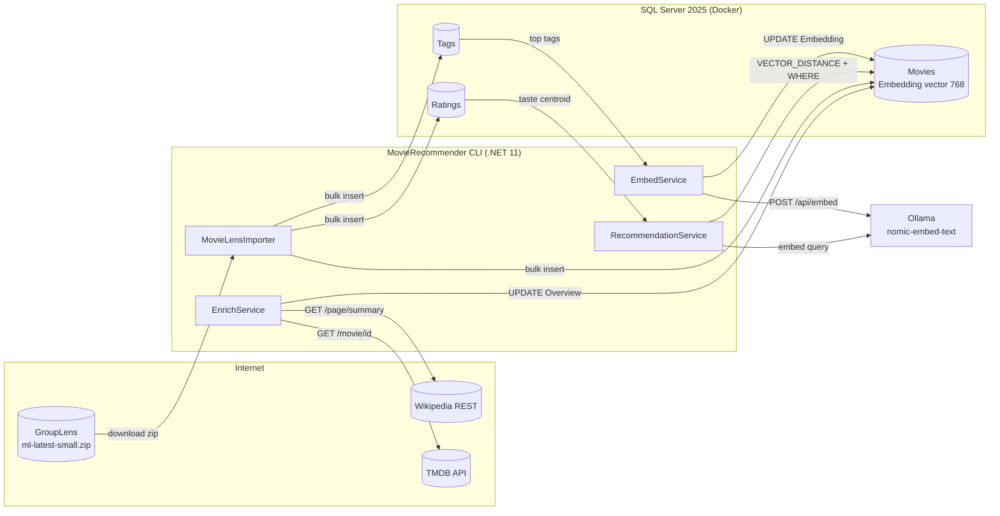
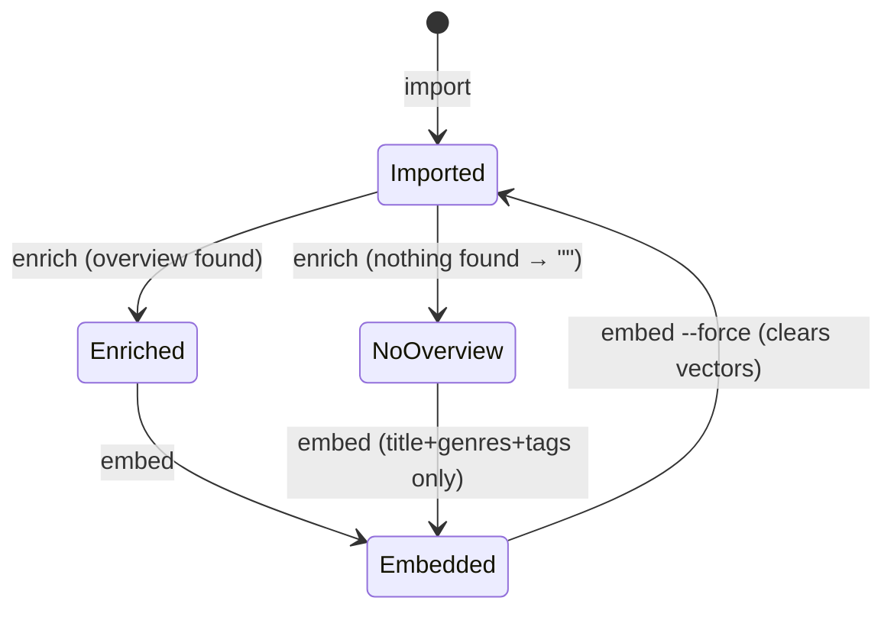
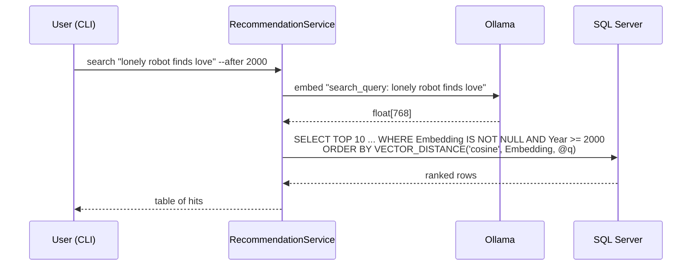
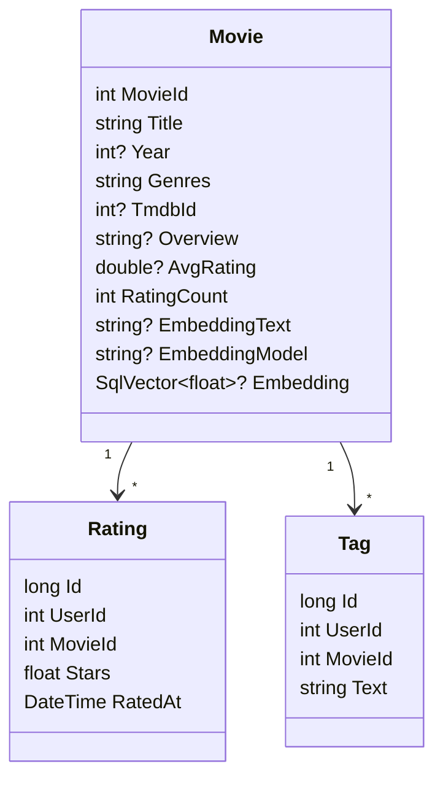

# Architecture

## 1. Big picture

```
                 ┌──────────────────────────────────────────────────────────────┐
                 │                 MovieRecommender (.NET 11 CLI)                │
                 │                                                              │
   internet      │  ┌─────────────┐   ┌─────────────┐   ┌─────────────┐          │
  ┌─────────┐    │  │  import     │──▶│  enrich     │──▶│  embed      │          │
  │GroupLens│───▶│  │ CSV → rows  │   │ overviews   │   │ text → vec  │          │
  │ zip     │    │  └─────────────┘   └──────┬──────┘   └──────┬──────┘          │
  └─────────┘    │                           │                 │                 │
  ┌─────────┐    │                           │ HTTP            │ HTTP            │
  │ TMDB /  │◀───│───────────────────────────┘                 │                 │
  │Wikipedia│    │                                             ▼                 │
  └─────────┘    │                                     ┌───────────────┐         │
                 │  ┌───────────────────────────┐      │    Ollama     │         │
                 │  │ search / similar / for-user│◀────▶│nomic-embed-   │         │
                 │  │   (RecommendationService)  │      │text  (768-d)  │         │
                 │  └─────────────┬─────────────┘      └───────────────┘         │
                 └────────────────┼───────────────────────────────────────────────┘
                                  │ EF Core 11  (LINQ → T-SQL)
                                  ▼
                 ┌──────────────────────────────────────────────────────────────┐
                 │  SQL Server 2025  (Docker, container vector-demo-sql)         │
                 │                                                              │
                 │   Movies ──1:N── Ratings          Movies.Embedding vector(768)│
                 │     └────1:N── Tags               ORDER BY VECTOR_DISTANCE() │
                 └──────────────────────────────────────────────────────────────┘
```



## 2. Data pipeline — each step is idempotent

The three "NULL means not done yet" columns make every step safe to re-run:

```
  Movies row lifecycle

   import            enrich                       embed
  ────────▶ Overview = NULL ────────▶ Overview = "text" | "" ────────▶ Embedding = vector
                                      (""  = tried, nothing found)
```



`sync` simply runs the four steps in order. Because each step filters on
`Overview IS NULL` / `Embedding IS NULL`, re-running costs almost nothing once complete.

## 3. What gets embedded

```
"search_document: Toy Story (1995). Genres: Adventure,Animation,Children,Comedy,Fantasy.
 Tags: pixar, fun. Toy Story is a 1995 American animated adventure comedy film ..."
```

- `search_document:` — nomic-embed-text is asymmetric; documents and queries use different prefixes.
- Title/year/genres — structured metadata the model can exploit ("90s animated").
- Up to 5 most common user tags — crowd-sourced semantics ("mind-bending", "twist ending").
- Overview — the main semantic content.

The exact text is stored in `Movies.EmbeddingText` so you can always see what the model saw.

## 4. Query paths



| Command | Query vector comes from | Model call? |
|---|---|---|
| `search <text>` | Ollama embeds the text | yes |
| `similar <title>` | the anchor movie's stored vector | no |
| `for-user <id>` | weighted average of vectors of the user's ≥4★ movies | no |

### The one query that matters

```csharp
db.Movies
  .Where(m => m.Embedding != null)
  .Where(m => m.Year >= 2000)                       // ordinary relational filter
  .Select(m => new Hit(..., EF.Functions.VectorDistance("cosine", m.Embedding!.Value, vec)))
  .OrderBy(h => h.Distance)
  .Take(10)
```

```sql
SELECT TOP(@top) [m].[MovieId], [m].[Title], ...,
       VECTOR_DISTANCE('cosine', [m].[Embedding], @vec) AS [Distance]
FROM [Movies] AS [m]
WHERE [m].[Embedding] IS NOT NULL AND [m].[Year] >= 2000
ORDER BY VECTOR_DISTANCE('cosine', [m].[Embedding], @vec)
```

This is an **exact** (brute-force) scan: SQL Server computes the distance for every candidate
row. For ~10k × 768 floats (~30 MB) it takes a few milliseconds. At millions of rows you would
add a DiskANN vector index for approximate nearest-neighbour search. Status (Oct 2026): GA in
Azure SQL Database / Fabric / MI always-up-to-date, **preview in SQL Server 2025** (our Docker
container). To experiment locally:

```sql
ALTER DATABASE SCOPED CONFIGURATION SET PREVIEW_FEATURES = ON;   -- required in SQL Server 2025
CREATE VECTOR INDEX IX_Movies_Embedding ON Movies(Embedding)
    WITH (METRIC = 'cosine', TYPE = 'DiskANN');
-- queries then use VECTOR_SEARCH(...) instead of ORDER BY VECTOR_DISTANCE(...)
```

Caveats: the indexed table becomes read-only, EF Core does not translate `VECTOR_SEARCH` yet
(use `FromSqlRaw`), and Microsoft has announced the current on-disk format will need migration
in a future release. Do this only after `enrich`/`embed` are complete.

## 5. Content-based user recommendations (`for-user`)

```
  user's ratings                 embeddings                 taste vector
  ┌───────────────┐             ┌──────────┐
  │ Matrix    5★  │──w=1.5────▶ │ v₁       │ ─┐
  │ Inception 4★  │──w=0.5────▶ │ v₂       │ ─┼─ Σ wᵢ·vᵢ / Σ wᵢ ──▶  c  ──▶ nearest unseen movies
  │ Memento   4.5★│──w=1.0────▶ │ v₃       │ ─┘
  │ Cats      1★  │  (ignored, < 4★)
  └───────────────┘
```

No training, no matrix factorisation: the "model" is just the geometry of the embedding
space. It is a good baseline and explainable — you can print the liked movies that formed the
centroid.

## 6. Code map

```
Program.cs                         composition root (DI, logging) + command dispatcher
Models/Entities.cs                 Movie, Rating, Tag, EmbeddingConfig
Data/MovieDbContext.cs             EF model config (vector column, indexes), design-time factory, AppSettings
Services/MovieLensImporter.cs      zip download, CSV parsing (CsvHelper 34), batched inserts
Services/OverviewProviders.cs      IOverviewProvider: TMDB (key) and Wikipedia (no key)
Services/EnrichService.cs          parallel, resumable overview fetching
Services/EmbedService.cs           document text composition, batched Ollama embedding
Services/RecommendationService.cs  search / similar / for-user LINQ queries
Migrations/                        EF Core migrations (schema as code)
docker-compose.yml                 SQL Server 2025, shared volume with ../vector-search-ef
```



## 7. Gotchas discovered while building this

1. **Nullable `SqlVector<float>?` on entities (EF Core 11.0.0).** Loading a `Movie` entity
   returns `Embedding == null` even when the column has data; reading the same column through
   a `.Select(...)` projection works. The code therefore reads vectors only via projections and
   uses `EmbeddingText` as the "has a vector" marker. (Writing vectors through entities works.)
2. **EF can't translate `OrderBy` over a record constructor.** `.Select(m => new Hit(...)).OrderBy(h => h.Distance)`
   fails; project to an anonymous type first, order, then map to the record.
3. **Wikipedia throttles eager clients hard.** The first run used 8 parallel requests and got
   `429 Retry-After: 45s` for the rest of the evening. Default is now 4; the provider honours
   `Retry-After` and leaves failed rows `NULL` so the next run retries them. Use a TMDB key
   for the full dataset.
4. **Asymmetric embedding prefixes.** nomic-embed-text wants `search_document:` / `search_query:`;
   forgetting them silently degrades ranking.

## 8. Where this differs from pgvector

| | SQL Server 2025 | pgvector |
|---|---|---|
| Type | `vector(n)` float32, ≤ 1998 dims | `vector`, `halfvec`, `sparsevec`, `bit` |
| Distances | cosine, euclidean, dot | + L1, Hamming, Jaccard |
| ANN index | DiskANN (preview) | HNSW, IVFFlat (mature) |
| EF Core | built-in via `SqlVector<float>` | `Npgsql` + `pgvector` package |

For datasets of this size both are exact-scan and equivalent; the choice is about which
database you already run.
